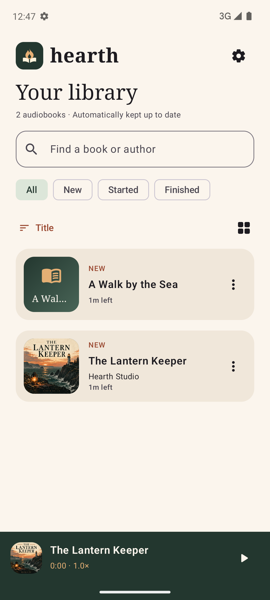
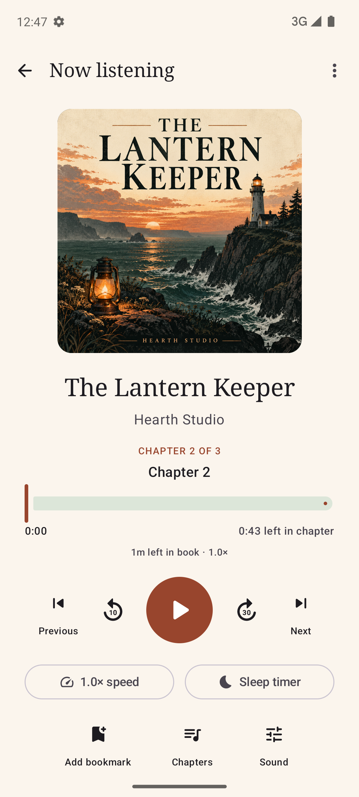

# Hearth

An offline audiobook player for Android, written in Kotlin and Jetpack Compose. Organize your library, follow chapter progress, and pick up where you left off.

**Coming soon to Google Play.**

[Privacy policy](https://rmessenger.github.io/hearth/privacy.html)

## Screenshots

<p>
  
  
</p>

## Use it

Install the signed APK, open Hearth, and choose your audiobook folder. Put each book in a subfolder; author/book nesting is supported. Folder JPG/PNG covers and embedded artwork are recognized. No account or network permission is required.

Opening a book restores its position without starting playback; tap Play when ready. Returning to a book that is already playing keeps playback running.

The library refreshes on return to the app and checks for changes while open. There is no reload button. Keep original files in the selected folder; Hearth reads them in place.

## Included

- MP3, M4B/M4A, AAC, Ogg/Opus, FLAC, and WAV playback through Media3, subject to device codec support.
- Background playback, system media controls, headset buttons, audio-focus handling, and pause on headset disconnection.
- Independent saved positions and playback speeds for each book; natural file ordering and cross-file seeking.
- Embedded M4B chapters, supporting Nero chapter lists and QuickTime text chapter tracks. Previous/Next navigate chapters across files; files without chapter markers act as individual chapters.
- Current chapter title, chapter scrubber, speed-adjusted chapter time remaining, overall book time remaining, and current-chapter highlighting in the chapter list. The separate 10-second back and 30-second forward controls skip by time.
- Playback speed from 0.5× to 3×, silence skipping, configurable resume rewind, equalizer presets, and volume boost.
- Sleep countdown with fade-out, end-of-file stop, and optional shake to reset/resume.
- Bookmarks, position history, character notes, listening totals, and New/Started/Finished classification.
- Search, sorting, list/grid layouts, light/dark themes, and a home-screen playback widget.

This first version focuses on the offline player. Chromecast, audio conversion, online cover/description lookup, and scheduled sleep timers are not implemented. Media-library integration is present, but Android Auto and physical Bluetooth/headset hardware have not been certified or road-tested. There is no DRM support.

Progress is local to this installation. Uninstalling or clearing app data removes progress and notes; it does not remove the audiobook files. Cloud backup and device transfer are disabled because persisted storage grants are device-specific.

## Build

Requirements: JDK 21, Android SDK platform 36, and Android SDK build tools. Android Studio can open this directory directly. Set `sdk.dir` in an untracked `local.properties`, or set `ANDROID_HOME`.

```sh
export JAVA_HOME=/opt/homebrew/opt/openjdk@21/libexec/openjdk.jdk/Contents/Home
./gradlew assembleDebug
./gradlew testDebugUnitTest lintDebug
./gradlew assembleRelease testReleaseUnitTest lintRelease
```

The debug APK is `app/build/outputs/apk/debug/app-debug.apk`. The optimized, non-debuggable release APK is `app/build/outputs/apk/release/app-release-unsigned.apk`; R8 code optimization and resource shrinking are enabled. Sign it with `apksigner` before installing. For a personal upgrade over an existing debug installation, use the same local debug key to retain data. This does not enable debugging in the release build. Use a dedicated release key for production distribution; no signing secrets are committed.

## Device tests

Use a disposable emulator. The tests exercise the real folder picker, storage provider, ExoPlayer, background service, and Android media buttons. They create and remove only their own `HearthIntegration-*` book folders under `/sdcard/Audiobooks`.

```sh
export ANDROID_SERIAL=emulator-5554
scripts/seed-test-library.sh
./gradlew connectedDebugAndroidTest
```

The seed script needs `adb` and `ffmpeg` in PATH. Tests cover automatic addition/removal, natural ordering, cover detection, speed/position persistence, background playback, media pause, cross-file seeks/history, and end-of-file sleep. JVM tests cover timeline arithmetic and both M4B chapter formats. See [validation notes](docs/validation.md).
